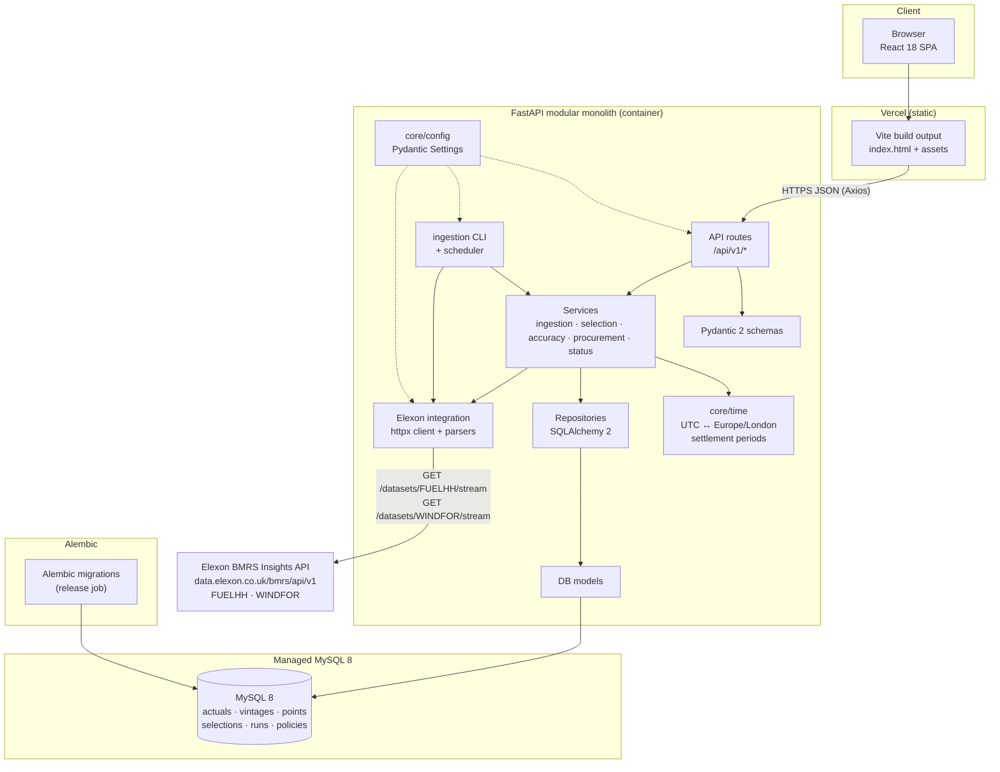

# WindPulse UK — Renewables Forecast & Procurement Intelligence Platform

## Stage 1 — Software Architecture and Project Planning

**Status:** planning only. No implementation code written.
**Prepared:** 16 November 2026
**Scope:** national UK wind generation only (Elexon BMRS `FUELHH` actuals, `WINDFOR` forecasts).

---

## 0. Verification log — what was checked, and how

Everything below marked **VERIFIED** was read from the official Elexon documentation
(`https://bmrs.elexon.co.uk/api-documentation`) or observed in a live HTTP 200 response from
`https://data.elexon.co.uk/bmrs/api/v1` made while preparing this document. No forecast values,
accuracy numbers or other results in this document are real analysis output; the only numbers
quoted from the API are structural observations (row counts, timestamps, granularity), explicitly
labelled as such.

### 0.1 Verified API facts

| # | Fact | Evidence |
|---|------|----------|
| 1 | Base URL is `https://data.elexon.co.uk/bmrs/api/v1`; docs live at `bmrs.elexon.co.uk/api-documentation`. | Docs; live 200s |
| 2 | **No API key or authentication** is required: "All our APIs are public and no API key is required." | Developer portal |
| 3 | Rate limit is **5,000 requests/minute per user**; exceeding it returns **429**. Some endpoints have additional per-endpoint limits. | Guidance page |
| 4 | Stream endpoints are **not paginated**: "no restrictions or limits on data return", JSON only, no envelope. | Guidance page |
| 5 | `GET /datasets/FUELHH/stream` params: `publishDateTimeFrom`, `publishDateTimeTo`, `settlementDateFrom`, `settlementDateTo` (`yyyy-MM-dd`), `settlementPeriod[]`, `fuelType[]`. **Settlement-date params cannot be combined with publish-date params.** | Docs |
| 6 | `FUELHH/stream` returns a **bare JSON array** (not `{"data": [...]}`), rows: `dataset`, `publishTime`, `startTime`, `settlementDate`, `settlementPeriod`, `fuelType`, `generation`. | Live probe |
| 7 | `GET /datasets/WINDFOR/stream` accepts **only** `publishDateTimeFrom` / `publishDateTimeTo`. With no params it returns **one** vintage (the latest published). | Docs; live probe |
| 8 | `WINDFOR` rows: `dataset`, `publishTime`, `startTime`, `generation` — **no `settlementDate` and no `settlementPeriod`**. Settlement period must be derived from `startTime`. | Live probe |
| 9 | **`WINDFOR` is hourly resolution**, not half-hourly: 73 points per vintage, consecutive `startTime` values exactly 60 minutes apart, spanning ~72 h. | Live probe: gaps = `[60]` min, 73 rows |
| 10 | A `WINDFOR` vintage covers roughly **publish_time − 7 h to publish_time + 64 h** (observed: publish 2026-01-05T04:30Z, points 2026-01-04T21:00Z → 2026-01-07T21:00Z). | Live probe |
| 11 | `WINDFOR` publication cadence is **irregular**, not a fixed interval. On 2026-01-06 the vintages were published at 02:30, 04:30, 07:30, 09:30, 11:30, 15:30, 18:30, 22:30 UTC (**8 vintages/day**, gaps of 2–4 h). | Live probe |
| 12 | `(publishTime, startTime)` is unique within `WINDFOR` — usable as the natural identity of a forecast point. | Live probe: 146 unique of 146 |
| 13 | A publish-window query returns **each vintage with its complete horizon**, not truncated rows. | Live probe: 73 rows for each of both vintages |
| 14 | `FUELHH?fuelType=WIND` gives **48 settlement periods per day**, `settlementPeriod` 1–48, one row per `(settlementDate, settlementPeriod)`, no duplicates. | Live probe: 96 rows over 2 days, 96 unique keys |
| 15 | `FUELHH` `publishTime` is a **per-row publication/run time** (96 distinct values in 96 rows), i.e. outturn rows carry their own revision timestamp. | Live probe |
| 16 | `FUELHH` rows are returned in **descending** `startTime` order; ordering must not be relied upon. | Live probe |
| 17 | January 2026 data is still retrievable on 16 Nov 2026, so retention is **at least ~10 months**. | Live probe |
| 18 | Volume is small: ~584 `WINDFOR` rows/day (8 vintages × 73) and 48 `FUELHH` rows/day. Jan–Feb 2026 ≈ 36k forecast rows + ~3k actual rows. | Live probe extrapolation |
| 19 | The `FUELHH/stream` **documentation example** shows `"dataset": "FUELINST"` — a docs copy error; the live response returns `FUELHH`. Parsers must tolerate this field's value rather than trusting the example. | Docs vs probe |
| 20 | Errors are **400** (bad query parameter), **429** (rate limit), **500** (server error). Stream-endpoint error detail is carried in the response trailer header. | Docs |

### 0.2 Documented uncertainties (not guessed, resolved in Stage 2)

| ID | Uncertainty | Handling now | Resolution |
|----|-------------|--------------|------------|
| U1 | Whether a **maximum publish window per request** exists for `/stream`. Docs are silent; a 1-day window (65 KB) worked. | Chunk all queries to **≤ 1 day per request** regardless. | Probe larger windows behind a feature flag in Stage 2. |
| U2 | Whether `WINDFOR` ever publishes **fewer/more** points per vintage, or skips a delivery day. | Selection algorithm tolerates missing hours and missing vintages; coverage is measured, not assumed. | Measure over Jan–Feb 2026 during ingestion. |
| U3 | Whether `FUELHH` `WIND` (transmission-metered + embedded estimates) is exactly the same population as `WINDFOR` (national wind forecast). | Treated as the only permitted pairing; comparability caveat documented in-app and in methodology. | Investigate BMRS dataset notes in Stage 2; document finding. |
| U4 | Whether a vintage's value for a given hour can be **revised** under the same `publishTime` (same key, different MW). | Schema allows update; any change is logged as a `data_quality_issue` rather than silently overwritten. | Check during ingestion; zero occurrences so far. |
| U5 | Whether `FUELHH` can return `null` or negative `generation` for `WIND`. | All metrics handle null explicitly; no zero-imputation anywhere. | Monitor via data-quality counters. |
| U6 | Whether the 8-vintages/day cadence is stable across the whole period (holidays, outages). | Ingestion is **discovery-based** (publish-window queries), never cron-assumption-based. | Count vintages/day during backfill. |
| U7 | The exact publication latency of the `WINDFOR` file relative to its `publishTime`. | Lead time computed from `publishTime` (documented, conservative). | Compare with arrival times in later stages. |

### 0.3 Verified business-timing fact: the day-ahead cutoff

The GB day-ahead market is not a single auction. EPEX SPOT's GB Day-Ahead 60-minute auction
closes at **09:20 Europe/London on D-1**; Nord Pool's N2EX GB day-ahead auction closes at
**09:50**; EPEX runs a GB Day-Ahead 30-minute auction at **15:30 D-1**. Sources: EPEX SPOT
Operational Rules (GB Day-Ahead 60min auction, 09:20 GMT/BST, D-1), EPEX SPOT "Basics of the
Power Market" (GB 10:20 label on a CET-referenced page), Nord Pool N2EX support article (09:50
gate closure), and the DESNZ consultation response referencing "the two hourly day-ahead GB
auctions which currently take place at 09:20 and 09:50".

**Decision:** the default policy is the **conservative earliest hourly gate closure, 09:20
Europe/London on D-1** (`EPEX_GB_DA_1H_0920`). It is a database row, not a constant: `09:50` and
`15:30` policies ship as non-default rows so results can be re-run under a different commercial
assumption without code changes. The chosen policy ID is recorded on every selection row, so any
reported number can be traced to the cutoff that produced it.

> Note: "09:20 local" is a wall-clock rule in a tz database zone, not a fixed UTC offset. In
> January/February 2026 the UK is on GMT, so D-1 09:20 local = 09:20Z. The implementation must
> still resolve the offset per date (BST from 29 March 2026), which is exactly why the policy is
> stored as `local_time` + `timezone_id`.

---

## 1. Business requirements breakdown

### 1.1 Actors

| Actor | Goal |
|-------|------|
| Procurement analyst | See the forecast that was actually available at the decision cutoff, and act on it. |
| Trading / risk analyst | Understand how wrong forecasts have been, and where the risk sits. |
| Engineering reviewer (hiring panel) | Confirm correctness, data provenance and maintainability. |
| Ingestion operator | Backfill, monitor and repair data. |

### 1.2 Functional requirements

| ID | Requirement | Acceptance criteria |
|----|-------------|---------------------|
| FR-01 | Ingest national wind **actual** generation from `FUELHH` (fuelType `WIND`) into MySQL, preserving settlement date/period, UTC timestamps and the source publication time. | Re-running the same window is idempotent: row counts unchanged, no duplicates. |
| FR-02 | Ingest **all** `WINDFOR` vintages (every distinct `publishTime`) into MySQL without collapsing them. | Two vintages for the same delivery hour coexist and are individually retrievable. |
| FR-03 | Provide a configurable **day-ahead decision cutoff**. | Changing the policy row changes selections and all derived results; nothing is hard-coded. |
| FR-04 | For each delivery interval, expose the **latest vintage published at or before the cutoff** (the "as-of" forecast). | Never selects a vintage with `publishTime > cutoff`; asserted by test. |
| FR-05 | Show the **vintage lineage** for a delivery interval (all vintages, publish times, values, lead times). | A chart and a table list every vintage available for a selected day. |
| FR-06 | Compute **MAE, RMSE, WAPE, signed bias**, daily accuracy, accuracy by lead-time bucket, and observation counts, over an arbitrary date range. | Totals reconcile with per-day sums; counts of excluded observations are returned. |
| FR-07 | Compute an **illustrative procurement delta** = demand scenario − selected forecast, per interval, with shortfall/surplus clearly signed, and an explicit disclaimer. | Positive = shortfall, negative = surplus, asserted by test; the response carries the disclaimer text and the MWh conversion. |
| FR-08 | Report **data status**: ingestion runs, per-day vintage coverage, actual completeness, data-quality issues. | Gaps visible without querying the API manually; coverage % per day. |
| FR-09 | Display all timestamps in **Europe/London** while storing **UTC**. | A BST-season date renders one hour ahead of UTC; a 46/50-SP day is handled. |
| FR-10 | Provide a runnable **backfill** for Jan 2026 (+ the Dec 2025 vintages needed to serve Jan deliveries, + Feb 2026 deliveries). | Single documented command; deterministic result. |
| FR-11 | Surface **methodology and caveats** in the UI (definitions, hourly-forecast caveat, comparability caveat, illustrative-only disclaimer). | Reachable page; wording matches this document. |

### 1.3 Non-functional requirements

| ID | Requirement |
|----|-------------|
| NFR-01 | Reproducibility: identical inputs ⇒ identical metric outputs (deterministic ordering, no reliance on API row order, no `float` sums where `DECIMAL` is stored). |
| NFR-02 | Provenance: every stored value carries its source (`dataset`, `publishTime`/`source_publish_time_utc`, `ingestion_run_id`). |
| NFR-03 | Idempotent, restartable ingestion; a failed run is visible and re-runnable without duplication. |
| NFR-04 | No zero-imputation, no silent coalescing of nulls, no gap-filling in stored data. |
| NFR-05 | Configurable via environment (12-factor); no secrets in the repo. |
| NFR-06 | Bounded external load: chunked requests, retry with backoff, respect `429`, sequential by default. |
| NFR-07 | Test coverage: ≥85 % on backend `services/` and `integrations/`; metrics and cutoff logic at 100 % branch coverage. |
| NFR-08 | p95 API latency < 500 ms for range queries over the two-month dataset on a small instance. |
| NFR-09 | Accessible, responsive UI; charts degrade gracefully with no data; explicit empty/error states. |

### 1.4 Out of scope (stated, not implied)

Demand forecasting, price data, other fuel types, interconnector flows, bidding/scheduling
optimisation, user accounts, real-time (IRIS) streaming, intraday re-optimisation, automated
trading. No data is invented to fill these gaps; the procurement output is labelled illustrative
for exactly this reason.

### 1.5 Glossary

- **Settlement period (SP)** — 30-minute GB electricity trading interval; 48/day on GMT days, 46
  on the spring-forward day, 50 on the autumn-back day.
- **Vintage** — one published `WINDFOR` file, identified by its `publishTime`; contains a full
  horizon of hourly points.
- **Cutoff** — the instant after which a forecast may not be used for a decision.
- **Lead time** — delivery interval start − chosen vintage `publishTime`.
- **As-of forecast** — the selected latest vintage at or before the cutoff (point-in-time correct).

---

## 2. System architecture

### 2.1 Shape

A **modular monolith**: one FastAPI deployable, internally split into strict layers with an
enforced dependency direction, plus one React SPA and one batch ingestion CLI shipped inside the
same image. Chosen over microservices because the domain has one writer, one datastore and a
two-month analytical workload; a network boundary would add failure modes without adding
capability. The layering keeps the option to extract ingestion later, since ingestion talks to
repositories, never to HTTP route code.

Dependency direction (imports only ever point downwards):

```
api/routes  →  services  →  repositories  →  db/models
                    ↓
              integrations (Elexon)      schemas (Pydantic, shared boundary)
                    ↓
                 core/config, core/time, utils
```

Rules: routes contain no SQL and no business rules; services contain no `httpx` and no ORM query
construction beyond calling repositories; repositories contain no business rules and never commit
(repositories flush; the service/UoW owns the transaction); integrations return typed domain
objects, never raw dicts.

### 2.2 Components

**Backend (`backend/app/`)**

| Component | Responsibility |
|-----------|----------------|
| `core/config.py` | Pydantic-Settings: DB DSN, Elexon base URL, timeouts, retry policy, chunk sizes, CORS origins, default cutoff policy code, `WINDFOR→SP` mapping mode. |
| `core/time.py` | UTC↔`Europe/London` conversion, settlement-date/period ↔ UTC interval mapping, 46/48/50-SP day handling, cutoff resolution. Single source of truth for all time maths; no ad-hoc `pytz`. |
| `integrations/elexon/client.py` | `httpx.AsyncClient` wrapper: base URL, timeouts, retries/backoff on 429/5xx, `Retry-After`, request accounting, error taxonomy. |
| `integrations/elexon/schemas.py` | Row models for `FUELHH`/`WINDFOR` stream rows (bare-array tolerant, extra fields ignored, `dataset` value not trusted). |
| `integrations/elexon/actuals.py`, `forecasts.py` | Window chunking, response→domain mapping, validation, de-duplication within a response. |
| `repositories/*.py` | `ActualGenerationRepository`, `ForecastVintageRepository`, `ForecastSelectionRepository`, `IngestionRunRepository`, `CutoffPolicyRepository`, `MetricsQueryRepository` (read-only SQL for aggregates/joins). |
| `services/ingestion_service.py` | Orchestrates runs: create run → fetch → upsert → record quality issues → close run. |
| `services/forecast_selection_service.py` | Implements §8; persists selections per (policy, settlement date, SP). |
| `services/accuracy_service.py` | Implements §9 with pandas/NumPy over a typed frame; returns Pydantic result models. |
| `services/procurement_service.py` | Illustrative delta calculation and disclaimer payload. |
| `services/data_status_service.py` | Coverage, gaps, latest vintage, run history. |
| `api/routes/*` | Thin HTTP adapters, Pydantic request/response models, problem-details errors. |
| `db/models/*`, `db/session.py` | SQLAlchemy 2 (`Mapped`/`mapped_column`) models; sync engine + `Session` (PyMySQL). |
| `cli.py` | `ingest actuals`, `ingest forecasts`, `rebuild-selections`, `verify` commands. |

**Frontend (`frontend/src/`)**

| Component | Responsibility |
|-----------|----------------|
| `services/api.js` | Axios instance (base URL from env), response unwrapping, typed error normalisation. |
| `services/*.js` | One module per resource (forecast, accuracy, procurement, dataStatus). |
| `hooks/*.js` | `useFetch`-style data hooks with loading/error/empty state, `useAnalysisParams` (URL-synced filters), `useTimezone`, `useDebouncedValue`. |
| `pages/*` | Route-level composition only. |
| `components/*` | Presentational + chart components (Recharts), metric cards, tables, banners, states. |
| `layouts/AppLayout.jsx` | Sidebar/topbar, cutoff-policy and timezone indicators, footer disclaimers. |
| `utils/format.js`, `utils/time.js` | MW/MWh/percent formatting, `Intl.DateTimeFormat` with `Europe/London`. |

### 2.3 Key flows

**Backfill / incremental ingestion**
1. CLI or scheduled job calls `IngestionService.run(dataset, window)`.
2. `ingestion_run` row inserted with `status=running` and the requested window.
3. The window is split into ≤1-day chunks; each chunk becomes one `GET …/stream` request with an
   explicit `publishDateTimeFrom/To` (forecasts) or `settlementDateFrom/To + fuelType=WIND` (actuals).
4. Rows are validated (required fields, ISO-8601 parse, non-null `startTime`/`publishTime`); invalid
   rows are rejected and recorded, never repaired silently.
5. Upserts: `INSERT … ON DUPLICATE KEY UPDATE` against the unique keys in §5. Insert/update counts
   are accumulated; a changed value on an existing key raises a `data_quality_issue` (U4).
6. Run row is closed `succeeded`/`partial`/`failed` with counts, HTTP status and error code;
   `ingestion_watermark` advances only on success.

**Analysis request**
`GET /analysis/accuracy?from&to&cutoffPolicy` → route → `AccuracyService` → `MetricsQueryRepository`
(one indexed join of `forecast_selection` × latest actuals) → pandas aggregation → Pydantic result.

Selections are **materialised**, not recomputed per request: `forecast_selection` is rebuilt by
`rebuild-selections` when the cutoff policy or data changes. This keeps the expensive vintage walk
out of the request path and makes the "as-of" choice auditable in SQL.

### 2.4 Cross-cutting concerns

Structured JSON logging with `request_id` and `run_id`; correlation ID echo; problem-details error
envelope; request-scoped DB session with rollback on exception; CORS allow-list from config;
response caching headers for reference/metrics endpoints (short TTL, `private` not required —
dataset is public and contains no personal data); no PII anywhere.

---

## 3. Mermaid architecture diagram



---

## 4. Database ER diagram

```mermaid
erDiagram
    INGESTION_RUN ||--o{ ACTUAL_GENERATION : "loads"
    INGESTION_RUN ||--o{ FORECAST_VINTAGE : "first seen in"
    INGESTION_RUN ||--o{ DATA_QUALITY_ISSUE : "reports"
    FORECAST_VINTAGE ||--|{ FORECAST_POINT : "contains hourly points"
    CUTOFF_POLICY ||--o{ FORECAST_SELECTION : "governs"
    FORECAST_VINTAGE |o--o{ FORECAST_SELECTION : "is chosen as"
    PROCUREMENT_SCENARIO ||--o{ PROCUREMENT_SCENARIO_INTERVAL : "expands to"
    ACTUAL_GENERATION }o--|| INGESTION_RUN : "provenance"

    INGESTION_RUN {
        bigint id PK
        varchar dataset
        varchar run_type
        datetime6 window_from_utc
        datetime6 window_to_utc
        varchar status
        int rows_fetched
        int rows_inserted
        int rows_updated
        int rows_rejected
        smallint http_status
        varchar error_code
    }

    FORECAST_VINTAGE {
        bigint id PK
        datetime6 publish_time_utc UK
        datetime6 horizon_start_utc
        datetime6 horizon_end_utc
        smallint resolution_minutes
        smallint point_count
        bigint first_run_id FK
    }

    FORECAST_POINT {
        bigint vintage_id PK_FK
        datetime6 valid_from_utc PK
        datetime6 valid_to_utc
        decimal generation_mw
    }

    ACTUAL_GENERATION {
        bigint id PK
        date settlement_date
        tinyint settlement_period
        varchar fuel_type
        datetime6 start_time_utc
        datetime6 end_time_utc
        decimal generation_mw
        datetime6 source_publish_time_utc
        bigint ingestion_run_id FK
    }

    CUTOFF_POLICY {
        smallint id PK
        varchar code UK
        time local_time
        varchar timezone_id
        smallint offset_days
        boolean is_default
    }

    FORECAST_SELECTION {
        bigint id PK
        smallint cutoff_policy_id FK
        date settlement_date
        tinyint settlement_period
        datetime6 cutoff_utc
        bigint vintage_id FK
        datetime6 vintage_publish_time_utc
        int lead_time_minutes
        decimal forecast_mw
        tinyint fallback_depth
        varchar selection_status
    }

    DATA_QUALITY_ISSUE {
        bigint id PK
        bigint ingestion_run_id FK
        varchar dataset
        varchar issue_type
        varchar severity
        date settlement_date
        tinyint settlement_period
        varchar detail
    }

    PROCUREMENT_SCENARIO {
        bigint id PK
        varchar name
        decimal demand_mw
        date from_date
        date to_date
        smallint cutoff_policy_id FK
    }

    PROCUREMENT_SCENARIO_INTERVAL {
        bigint id PK
        bigint scenario_id FK
        date settlement_date
        tinyint settlement_period
        decimal demand_mw
        decimal forecast_mw
        decimal delta_mw
    }
```

---

## 5. Database schema with data types

### 5.1 Conventions

- Engine `InnoDB`, charset `utf8mb4`, collation `utf8mb4_0900_ai_ci`.
- **All instants are stored as `DATETIME(6)` in UTC**, with a `_utc` suffix. `TIMESTAMP` is
  avoided deliberately: it performs session-timezone conversion and carries a 2038 limit.
  Sessions run with `SET time_zone = '+00:00'`; `Europe/London` exists only at the presentation
  boundary (API serialisation adds `…Z` and an optional local rendering; the UI formats locally).
- Power is `DECIMAL(10,2)` MW (no binary-float drift in stored values); computed metrics use
  `DECIMAL(12,4)` where persisted, `float64` only inside pandas aggregation.
- Settlement date is `DATE` and settlement period `TINYINT UNSIGNED` with
  `CHECK (settlement_period BETWEEN 1 AND 50)` (50 allows autumn-back days).
- Every table has `created_at_utc DATETIME(6) NOT NULL DEFAULT (UTC_TIMESTAMP(6))`; mutable tables
  add `updated_at_utc … ON UPDATE`.

### 5.2 Tables

```sql
-- ─────────────────────────── ingestion_run ───────────────────────────
CREATE TABLE ingestion_run (
  id                  BIGINT UNSIGNED NOT NULL AUTO_INCREMENT,
  dataset             VARCHAR(16)  NOT NULL,               -- 'FUELHH' | 'WINDFOR'
  run_type            VARCHAR(16)  NOT NULL,               -- backfill | incremental | manual
  window_from_utc     DATETIME(6)  NOT NULL,
  window_to_utc       DATETIME(6)  NOT NULL,
  status              VARCHAR(16)  NOT NULL,               -- running | succeeded | partial | failed
  http_requests       INT UNSIGNED NOT NULL DEFAULT 0,
  rows_fetched        INT UNSIGNED NOT NULL DEFAULT 0,
  rows_inserted       INT UNSIGNED NOT NULL DEFAULT 0,
  rows_updated        INT UNSIGNED NOT NULL DEFAULT 0,
  rows_rejected       INT UNSIGNED NOT NULL DEFAULT 0,
  http_status         SMALLINT UNSIGNED NULL,
  error_code          VARCHAR(64)  NULL,
  error_message       VARCHAR(1000) NULL,
  payload_checksum    CHAR(64)     NULL,                   -- sha256 of concatenated raw bodies
  started_at_utc      DATETIME(6)  NOT NULL DEFAULT (UTC_TIMESTAMP(6)),
  finished_at_utc     DATETIME(6)  NULL,
  created_at_utc      DATETIME(6)  NOT NULL DEFAULT (UTC_TIMESTAMP(6)),
  PRIMARY KEY (id),
  KEY ix_run_dataset_started (dataset, started_at_utc),
  KEY ix_run_status (status, started_at_utc),
  CONSTRAINT chk_run_status
    CHECK (status IN ('running','succeeded','partial','failed'))
) ENGINE=InnoDB DEFAULT CHARSET=utf8mb4 COLLATE=utf8mb4_0900_ai_ci;

-- ──────────────────────── ingestion_watermark ────────────────────────
CREATE TABLE ingestion_watermark (
  dataset              VARCHAR(16) NOT NULL,
  last_success_to_utc  DATETIME(6) NOT NULL,
  last_run_id          BIGINT UNSIGNED NULL,
  updated_at_utc       DATETIME(6) NOT NULL DEFAULT (UTC_TIMESTAMP(6))
                                     ON UPDATE CURRENT_TIMESTAMP(6),
  PRIMARY KEY (dataset),
  KEY ix_wm_run (last_run_id)
) ENGINE=InnoDB DEFAULT CHARSET=utf8mb4 COLLATE=utf8mb4_0900_ai_ci;

-- ────────────────────────── forecast_vintage ─────────────────────────
-- One row per distinct WINDFOR publishTime. Never deleted, never merged.
CREATE TABLE forecast_vintage (
  id                   BIGINT UNSIGNED NOT NULL AUTO_INCREMENT,
  dataset              VARCHAR(16) NOT NULL DEFAULT 'WINDFOR',
  publish_time_utc     DATETIME(6) NOT NULL,
  horizon_start_utc    DATETIME(6) NOT NULL,
  horizon_end_utc      DATETIME(6) NOT NULL,               -- exclusive
  resolution_minutes   SMALLINT UNSIGNED NOT NULL DEFAULT 60,
  point_count          SMALLINT UNSIGNED NOT NULL DEFAULT 0,
  source_row_count     INT UNSIGNED NOT NULL DEFAULT 0,
  first_run_id         BIGINT UNSIGNED NULL,
  last_seen_run_id     BIGINT UNSIGNED NULL,
  created_at_utc       DATETIME(6) NOT NULL DEFAULT (UTC_TIMESTAMP(6)),
  updated_at_utc       DATETIME(6) NOT NULL DEFAULT (UTC_TIMESTAMP(6))
                                     ON UPDATE CURRENT_TIMESTAMP(6),
  PRIMARY KEY (id),
  UNIQUE KEY uq_vintage_dataset_publish (dataset, publish_time_utc),
  KEY ix_vintage_publish (publish_time_utc),
  KEY ix_vintage_horizon (horizon_start_utc, horizon_end_utc),
  CONSTRAINT fk_vintage_first_run FOREIGN KEY (first_run_id)
    REFERENCES ingestion_run (id) ON DELETE SET NULL,
  CONSTRAINT fk_vintage_last_run FOREIGN KEY (last_seen_run_id)
    REFERENCES ingestion_run (id) ON DELETE SET NULL
) ENGINE=InnoDB DEFAULT CHARSET=utf8mb4 COLLATE=utf8mb4_0900_ai_ci;

-- ─────────────────────────── forecast_point ──────────────────────────
-- Native hourly WINDFOR resolution is preserved exactly. No SP expansion is stored.
CREATE TABLE forecast_point (
  vintage_id      BIGINT UNSIGNED NOT NULL,
  valid_from_utc  DATETIME(6) NOT NULL,
  valid_to_utc    DATETIME(6) NOT NULL,                    -- valid_from + resolution
  generation_mw   DECIMAL(10,2) NULL,                      -- NULL allowed; never 0-filled
  created_at_utc  DATETIME(6) NOT NULL DEFAULT (UTC_TIMESTAMP(6)),
  PRIMARY KEY (vintage_id, valid_from_utc),
  KEY ix_point_valid_from (valid_from_utc),
  CONSTRAINT fk_point_vintage FOREIGN KEY (vintage_id)
    REFERENCES forecast_vintage (id) ON DELETE RESTRICT,
  CONSTRAINT chk_point_window CHECK (valid_to_utc > valid_from_utc)
) ENGINE=InnoDB DEFAULT CHARSET=utf8mb4 COLLATE=utf8mb4_0900_ai_ci;

-- ────────────────────────── actual_generation ────────────────────────
-- Revisions are preserved: an outturn row republished with a new publishTime is a new row.
CREATE TABLE actual_generation (
  id                       BIGINT UNSIGNED NOT NULL AUTO_INCREMENT,
  settlement_date          DATE NOT NULL,
  settlement_period        TINYINT UNSIGNED NOT NULL,
  fuel_type                VARCHAR(16) NOT NULL DEFAULT 'WIND',
  start_time_utc           DATETIME(6) NOT NULL,
  end_time_utc             DATETIME(6) NOT NULL,
  generation_mw            DECIMAL(10,2) NULL,
  source_publish_time_utc  DATETIME(6) NOT NULL,
  ingestion_run_id         BIGINT UNSIGNED NULL,
  created_at_utc           DATETIME(6) NOT NULL DEFAULT (UTC_TIMESTAMP(6)),
  updated_at_utc           DATETIME(6) NOT NULL DEFAULT (UTC_TIMESTAMP(6))
                                        ON UPDATE CURRENT_TIMESTAMP(6),
  PRIMARY KEY (id),
  UNIQUE KEY uq_actual_revision
    (settlement_date, settlement_period, fuel_type, source_publish_time_utc),
  KEY ix_actual_lookup (fuel_type, settlement_date, settlement_period),
  KEY ix_actual_start (start_time_utc),
  CONSTRAINT fk_actual_run FOREIGN KEY (ingestion_run_id)
    REFERENCES ingestion_run (id) ON DELETE SET NULL,
  CONSTRAINT chk_actual_sp CHECK (settlement_period BETWEEN 1 AND 50),
  CONSTRAINT chk_actual_window CHECK (end_time_utc > start_time_utc)
) ENGINE=InnoDB DEFAULT CHARSET=utf8mb4 COLLATE=utf8mb4_0900_ai_ci;

-- ──────────────────────────── cutoff_policy ──────────────────────────
CREATE TABLE cutoff_policy (
  id             SMALLINT UNSIGNED NOT NULL AUTO_INCREMENT,
  code           VARCHAR(32)  NOT NULL,                    -- EPEX_GB_DA_1H_0920
  name           VARCHAR(120) NOT NULL,
  local_time     TIME         NOT NULL,                    -- wall clock in timezone_id
  timezone_id    VARCHAR(64)  NOT NULL DEFAULT 'Europe/London',
  offset_days    SMALLINT     NOT NULL DEFAULT -1,         -- cutoff relative to delivery date
  is_default     BOOLEAN      NOT NULL DEFAULT FALSE,
  source_reference VARCHAR(255) NULL,                      -- citation for the rule
  notes          VARCHAR(500) NULL,
  created_at_utc DATETIME(6)  NOT NULL DEFAULT (UTC_TIMESTAMP(6)),
  updated_at_utc DATETIME(6)  NOT NULL DEFAULT (UTC_TIMESTAMP(6))
                              ON UPDATE CURRENT_TIMESTAMP(6),
  PRIMARY KEY (id),
  UNIQUE KEY uq_policy_code (code),
  KEY ix_policy_default (is_default)
) ENGINE=InnoDB DEFAULT CHARSET=utf8mb4 COLLATE=utf8mb4_0900_ai_ci;

-- ────────────────────────── forecast_selection ───────────────────────
-- Rebuildable materialisation of §8. One row per (policy, settlement date, period).
CREATE TABLE forecast_selection (
  id                       BIGINT UNSIGNED NOT NULL AUTO_INCREMENT,
  cutoff_policy_id         SMALLINT UNSIGNED NOT NULL,
  settlement_date          DATE NOT NULL,
  settlement_period        TINYINT UNSIGNED NOT NULL,
  interval_start_utc       DATETIME(6) NOT NULL,
  cutoff_utc               DATETIME(6) NOT NULL,
  vintage_id               BIGINT UNSIGNED NULL,
  vintage_publish_time_utc DATETIME(6) NULL,
  lead_time_minutes        INT NULL,                       -- interval_start - publish_time
  forecast_mw              DECIMAL(10,2) NULL,
  fallback_depth           TINYINT UNSIGNED NOT NULL DEFAULT 0,
  selection_status         VARCHAR(24) NOT NULL,           -- selected | no_vintage_before_cutoff
                                                           -- | no_point_for_interval
                                                           -- | interval_outside_horizon
  selected_at_utc          DATETIME(6) NOT NULL DEFAULT (UTC_TIMESTAMP(6)),
  PRIMARY KEY (id),
  UNIQUE KEY uq_selection (cutoff_policy_id, settlement_date, settlement_period),
  KEY ix_selection_vintage (vintage_id),
  KEY ix_selection_date (settlement_date, settlement_period),
  KEY ix_selection_status (selection_status),
  CONSTRAINT fk_selection_policy FOREIGN KEY (cutoff_policy_id)
    REFERENCES cutoff_policy (id) ON DELETE RESTRICT,
  CONSTRAINT fk_selection_vintage FOREIGN KEY (vintage_id)
    REFERENCES forecast_vintage (id) ON DELETE RESTRICT,
  CONSTRAINT chk_selection_sp CHECK (settlement_period BETWEEN 1 AND 50),
  CONSTRAINT chk_selection_lead CHECK (lead_time_minutes IS NULL OR lead_time_minutes >= 0)
) ENGINE=InnoDB DEFAULT CHARSET=utf8mb4 COLLATE=utf8mb4_0900_ai_ci;

-- ───────────────────────── data_quality_issue ────────────────────────
CREATE TABLE data_quality_issue (
  id               BIGINT UNSIGNED NOT NULL AUTO_INCREMENT,
  ingestion_run_id BIGINT UNSIGNED NULL,
  dataset          VARCHAR(16) NOT NULL,
  issue_type       VARCHAR(48) NOT NULL,   -- MISSING_ACTUAL, MISSING_FORECAST_VINTAGE,
                                           -- REVISED_VALUE, REJECTED_ROW, SHORT_HORIZON,
                                           -- DUPLICATE_IN_PAYLOAD, NO_POINT_FOR_INTERVAL
  severity         VARCHAR(8)  NOT NULL,   -- info | warning | error
  settlement_date  DATE NULL,
  settlement_period TINYINT UNSIGNED NULL,
  vintage_publish_time_utc DATETIME(6) NULL,
  detail           VARCHAR(1000) NULL,
  created_at_utc   DATETIME(6) NOT NULL DEFAULT (UTC_TIMESTAMP(6)),
  PRIMARY KEY (id),
  KEY ix_dqi_type_created (issue_type, created_at_utc),
  KEY ix_dqi_date (settlement_date, settlement_period),
  CONSTRAINT fk_dqi_run FOREIGN KEY (ingestion_run_id)
    REFERENCES ingestion_run (id) ON DELETE SET NULL,
  CONSTRAINT chk_dqi_severity CHECK (severity IN ('info','warning','error'))
) ENGINE=InnoDB DEFAULT CHARSET=utf8mb4 COLLATE=utf8mb4_0900_ai_ci;

-- ───────────────────── procurement_scenario (Stage 3) ────────────────
CREATE TABLE procurement_scenario (
  id               BIGINT UNSIGNED NOT NULL AUTO_INCREMENT,
  name             VARCHAR(120) NOT NULL,
  demand_mw        DECIMAL(10,2) NOT NULL,     -- constant demand for the window (MVP input)
  from_date        DATE NOT NULL,
  to_date          DATE NOT NULL,
  cutoff_policy_id SMALLINT UNSIGNED NOT NULL,
  notes            VARCHAR(500) NULL,
  created_at_utc   DATETIME(6) NOT NULL DEFAULT (UTC_TIMESTAMP(6)),
  PRIMARY KEY (id),
  KEY ix_scenario_window (from_date, to_date),
  CONSTRAINT fk_scenario_policy FOREIGN KEY (cutoff_policy_id)
    REFERENCES cutoff_policy (id) ON DELETE RESTRICT,
  CONSTRAINT chk_scenario_window CHECK (to_date >= from_date),
  CONSTRAINT chk_scenario_demand CHECK (demand_mw >= 0)
) ENGINE=InnoDB DEFAULT CHARSET=utf8mb4 COLLATE=utf8mb4_0900_ai_ci;

CREATE TABLE procurement_scenario_interval (
  id              BIGINT UNSIGNED NOT NULL AUTO_INCREMENT,
  scenario_id     BIGINT UNSIGNED NOT NULL,
  settlement_date DATE NOT NULL,
  settlement_period TINYINT UNSIGNED NOT NULL,
  demand_mw       DECIMAL(10,2) NOT NULL,
  forecast_mw     DECIMAL(10,2) NULL,
  delta_mw        DECIMAL(10,2) NULL,          -- demand - forecast; NULL when forecast NULL
  PRIMARY KEY (id),
  UNIQUE KEY uq_scenario_interval (scenario_id, settlement_date, settlement_period),
  CONSTRAINT fk_si_scenario FOREIGN KEY (scenario_id)
    REFERENCES procurement_scenario (id) ON DELETE CASCADE
) ENGINE=InnoDB DEFAULT CHARSET=utf8mb4 COLLATE=utf8mb4_0900_ai_ci;
```

### 5.3 Views (single definition of "latest actual" and of the analysis join)

```sql
-- Latest revision per settlement period; the only sanctioned way to read actuals.
CREATE VIEW v_actual_generation_latest AS
SELECT a.*
FROM actual_generation a
JOIN (
  SELECT settlement_date, settlement_period, fuel_type,
         MAX(source_publish_time_utc) AS max_publish
  FROM actual_generation
  GROUP BY settlement_date, settlement_period, fuel_type
) m
  ON  m.settlement_date   = a.settlement_date
  AND m.settlement_period = a.settlement_period
  AND m.fuel_type         = a.fuel_type
  AND m.max_publish       = a.source_publish_time_utc;

-- One row per evaluated interval: as-of forecast + latest actual. NULLs preserved.
CREATE VIEW v_analysis_interval AS
SELECT s.cutoff_policy_id,
       s.settlement_date,
       s.settlement_period,
       s.interval_start_utc,
       s.cutoff_utc,
       s.vintage_id,
       s.vintage_publish_time_utc,
       s.lead_time_minutes,
       s.forecast_mw,
       a.generation_mw AS actual_mw,
       s.selection_status
FROM forecast_selection s
LEFT JOIN v_actual_generation_latest a
  ON  a.settlement_date   = s.settlement_date
  AND a.settlement_period = s.settlement_period
  AND a.fuel_type         = 'WIND';

-- Daily vintage coverage (does a decision-ready vintage exist for each delivery day?).
CREATE VIEW v_forecast_coverage_daily AS
SELECT s.cutoff_policy_id,
       s.settlement_date,
       COUNT(*)                                                  AS intervals,
       SUM(s.selection_status = 'selected')                       AS selected_intervals,
       SUM(s.vintage_id IS NULL)                                  AS missing_intervals,
       MIN(s.vintage_publish_time_utc)                            AS earliest_used_vintage,
       MAX(s.vintage_publish_time_utc)                            AS latest_used_vintage,
       MIN(s.lead_time_minutes)                                   AS min_lead_minutes,
       MAX(s.lead_time_minutes)                                   AS max_lead_minutes
FROM forecast_selection s
GROUP BY s.cutoff_policy_id, s.settlement_date;
```

### 5.4 Index rationale

- `uq_vintage_dataset_publish` makes forecast re-ingestion idempotent at the vintage level.
- `(vintage_id, valid_from_utc)` primary key gives the selection query an index-only range scan
  for "does this vintage contain this hour?".
- `ix_point_valid_from` supports horizon-coverage questions across vintages.
- `uq_actual_revision` makes actuals idempotent while permitting genuine revisions;
  `ix_actual_lookup` serves the range read behind every metric query.
- `uq_selection (policy, settlement_date, period)` is the join key of the analysis view and makes
  `rebuild-selections` a pure upsert.
- `ix_selection_vintage` supports vintage-lineage queries without a table scan.

### 5.5 Seed data

`cutoff_policy` seeds: `EPEX_GB_DA_1H_0920` (default, 09:20 `Europe/London`, −1 day),
`N2EX_GB_DA_1H_0950` (09:50, −1), `EPEX_GB_DA_30M_1530` (15:30, −1). Each carries its citation in
`source_reference`. Seeds are created by Alembic data migrations (revisioned, not ad-hoc SQL).

---

## 6. API endpoint design

Base path `/api/v1`. Success envelope `{"data": …, "meta": {…}}`; errors follow RFC 7807-ish
problem details `{"error": {"code", "message", "details"}}` with `code` from a closed enum
(`VALIDATION_ERROR`, `NOT_FOUND`, `UPSTREAM_ERROR`, `CONFLICT`, `INTERNAL_ERROR`).

| Method | Path | Purpose | Key params | Notes |
|--------|------|---------|-----------|-------|
| GET | `/health` | Liveness | — | No DB touch. |
| GET | `/health/ready` | Readiness | — | `SELECT 1` + Alembic head check. |
| GET | `/meta/config` | Cutoff policies, timezone, data coverage, mapping mode, disclaimers | — | Drives UI badges. |
| GET | `/forecast/latest` | As-of forecast for one delivery day | `deliveryDate`*, `cutoffPolicy?` | Returns the selected series (`settlementDate`, `settlementPeriod`, `localStart`, `forecastMw`, `vintagePublishTime`, `leadTimeMinutes`). |
| GET | `/forecast/vintages` | All vintages for a delivery day | `deliveryDate`* | Lineage list: `publishTime`, `pointsInDay`, `leadTimeMinutes`, `isUsedAtCutoff`, `isAfterCutoff`. |
| GET | `/forecast/vintage/{id}` | One vintage's hourly series | `id`* | Hourly, UTC + local. |
| GET | `/actuals` | Actual WIND generation | `from`*, `to`*, `granularity=sp\|daily` | Latest revision per SP. |
| GET | `/analysis/accuracy` | Aggregate + series | `from`*, `to`*, `cutoffPolicy?`, `granularity=sp\|daily` | `maeMw`, `rmseMw`, `wapePct`, `biasMw`, `biasPct`, `nEvaluated`, `nMissingForecast`, `nMissingActual`, `coveragePct`, `daily[]`. |
| GET | `/analysis/accuracy/by-lead-time` | Metrics per lead-time bucket | same as above | Buckets per §9.4. |
| GET | `/analysis/error-distribution` | Histogram + bias by hour-of-day | `from`*, `to`* | Powers the error charts. |
| GET | `/analysis/vintage-evolution` | One delivery day, all vintages vs actual | `deliveryDate`* | The "how the forecast changed" chart. |
| POST | `/procurement/scenario` | Illustrative delta | body: `demandMw`, `from`, `to`, `cutoffPolicy?`, `persist?` | Returns per-interval delta, totals in MW·h, and `disclaimer`. `persist=true` stores a scenario. |
| GET | `/procurement/scenarios` | Saved scenarios | — | Stage 3. |
| GET | `/data/status` | Coverage, latest vintages, gaps | `from?`, `to?` | Non-200 beyond a configurable staleness threshold? No — 200 with `stale: true`. |
| GET | `/data/runs` | Ingestion run history | `limit`, `dataset?` | Paginated by keyset. |
| GET | `/data/issues` | Data-quality issues | `severity?`, `from?` | |
| POST | `/admin/ingest/actuals` | Trigger incremental actuals | header `X-Admin-Token` | Guarded; disabled without configured token. |
| POST | `/admin/ingest/forecasts` | Trigger forecast discovery | body `window` | Guarded. |
| POST | `/admin/selections/rebuild` | Rebuild selections | `cutoffPolicy?`, `from`, `to` | Guarded. |

Validation: `from`/`to` are `YYYY-MM-DD` (UK settlement dates) or ISO-8601 instants; the service
resolves them to UTC half-open intervals and rejects ranges > 180 days with `VALIDATION_ERROR`.
`demandMw` is `0 < x ≤ 100000`. `leadTimeMinutes` is always reported, never inferred.
Caching: `GET` analytics endpoints send `Cache-Control: public, max-age=60` (data is public and
changes only on ingestion); `/forecast/latest` uses `max-age=300`.

---

## 7. Elexon integration plan

### 7.1 Client behaviour

- `httpx.AsyncClient(base_url=settings.elexon_base_url)`, connect/read timeout 10 s/30 s,
  `follow_redirects=False`, `User-Agent: WindPulseUK/1.0 (+contact)`.
- **Requests:** `GET /datasets/FUELHH/stream` with `settlementDateFrom/To` + `fuelType=WIND`
  (never mixed with publish params — docs forbid it); `GET /datasets/WINDFOR/stream` with
  `publishDateTimeFrom/To` only, ISO-8601 UTC (`2026-01-05T00:00:00Z`).
- **Response parsing:** the `/stream` endpoints return a **bare list**; the non-stream endpoints
  return `{"data": [...]}`. The parser accepts both shapes (stream endpoints are the only ones
  used), ignores unknown fields, and does not trust the `dataset` field (docs show `FUELINST` in
  the FUELHH example).
- **Retry policy:** exponential backoff with jitter on 429/5xx/timeouts, max 4 attempts, honouring
  `Retry-After`; 400 is never retried (it means our parameters are wrong) and fails the chunk.
- **Load:** sequential requests per run with a small concurrency cap (default 2) and a hard budget
  per run; the documented ceiling is 5,000 req/min, our backfill needs on the order of 60–70
  requests, so the platform limit is never approached. No polling faster than the data changes
  (Elexon's terms call out over-polling half-hourly data as misuse).
- **Raw archive:** each response body is written gzipped to a volume at
  `data/raw/{dataset}/{yyyy}/{mm}/{dd}/{from}_{to}.json.gz` (dev/ops only, gitignored; DB is the
  source of truth) and its sha256 recorded on the run.

### 7.2 Windows and backfill

| Dataset | Query dimension | Chunk | Range to load |
|---------|-----------------|-------|---------------|
| `FUELHH` | `settlementDateFrom/To` | 7 days/request | 2026-01-01 → 2026-02-28 |
| `WINDFOR` | `publishDateTimeFrom/To` | 1 day/request | **2025-12-29T00:00Z → 2026-03-01T00:00Z** |

The forecast window starts before January because a Jan-1 delivery needs vintages published on
Dec 29–31; and extends past February because the last Feb deliveries use late-Feb/early-Mar
vintages. Total ≈ 63 forecast requests + 9 actual requests — trivially within limits.

Incremental runs: `FUELHH` re-reads the last 3 settlement days (revision capture); `WINDFOR`
queries a publish window from `watermark − 6 h` to now (overlap absorbs late arrivals; upserts make
re-reads harmless).

### 7.3 Idempotency and validation

- Forecast: `(publish_time_utc)` → vintage upsert; `(vintage_id, valid_from_utc)` → point upsert.
  A re-read that changes `generation_mw` for an existing key logs `REVISED_VALUE` and updates.
- Actuals: `(settlement_date, settlement_period, fuel_type, source_publish_time_utc)` → insert
  or no-op; a *new* publish time for the same SP is a legitimate revision row (never an overwrite).
- Rejected rows (missing `startTime`/`publishTime`, unparseable timestamp, non-numeric
  `generation`, `startTime` not aligned to the expected resolution) increment `rows_rejected` and
  emit a `REJECTED_ROW` issue. Nothing is silently coerced.
- `startTime` misalignment, short horizons and empty chunks are recorded as issues
  (`SHORT_HORIZON`, `EMPTY_WINDOW`) so coverage problems surface as data, not as mystery nulls.

### 7.4 Scheduling

`cli.py` plus an external scheduler:
- **Local/dev:** a `scheduler` compose profile (APScheduler, interval jobs: actuals every 30 min,
  forecast discovery every 30 min, selections rebuild hourly).
- **Production:** GitHub Actions cron (or the host's cron) invoking a one-shot container command.
  Ingestion never runs inside the web process, so scaling the API cannot duplicate workers.

---

## 8. Forecast vintage selection algorithm

### 8.1 Definitions

- `I = (settlement_date, settlement_period)` → half-open interval `[start_utc, end_utc)`,
  `end_utc = start_utc + 30 min`, derived from `Europe/London` local midnight for that settlement
  date (so 46/50-SP days are handled by construction).
- `cutoff_utc = localise(policy.local_time, delivery_date + policy.offset_days, Europe/London) → UTC`.
  For `EPEX_GB_DA_1H_0920` and delivery 2026-01-15: `2026-01-14T09:20:00Z` (GMT).
- `bucket_start_utc = floor_to_hour(start_utc)` because `WINDFOR` is hourly (§0.1 #9).

### 8.2 Mapping WINDFOR hours onto settlement periods

Hourly forecast, half-hourly delivery. Primary mode **`step`** (the forecast valid for the hour
containing the SP start is used; the two SPs inside an hour share the value). Alternative mode
**`linear`** (interpolate between the two surrounding hourly points at the SP midpoint) is
configurable but **non-default**, because interpolation manufactures values that Elexon never
published. Both are documented in the UI, and the active mode is stored in `/meta/config` and used
in every response's `meta`. Metrics are additionally reportable at native hourly grain
(`granularity=hourly`), which contains no duplication and is the honest basis for statistical
claims; the half-hourly view exists because procurement is settled half-hourly. That caveat is
stated in the methodology page rather than hidden.

### 8.3 Algorithm (deterministic, auditable)

```
for each delivery interval I in [from_date .. to_date] × periods(I.settlement_date):
    cutoff_utc = resolve_cutoff(I.settlement_date, policy)
    bucket     = floor_to_hour(I.start_utc)

    # 1. Candidate vintages: published at or before the cutoff. Strict, no tolerance.
    candidates = SELECT v.id, v.publish_time_utc
                 FROM forecast_vintage v
                 WHERE v.publish_time_utc <= cutoff_utc
                 ORDER BY v.publish_time_utc DESC, v.id DESC

    # 2. Walk newest → oldest; take the first vintage that actually covers this hour.
    chosen = null
    for (depth, v) in enumerate(candidates):
        p = SELECT generation_mw FROM forecast_point
            WHERE vintage_id = v.id AND valid_from_utc = bucket
        if p exists:
            chosen = (v, p, depth); break

    # 3. Persist exactly what happened, including failure to find anything.
    upsert forecast_selection(
        policy, I.settlement_date, I.settlement_period,
        interval_start_utc = I.start_utc,
        cutoff_utc         = cutoff_utc,
        vintage_id         = chosen?.v.id,
        vintage_publish_time_utc = chosen?.v.publish_time_utc,
        lead_time_minutes  = chosen ? minutes(I.start_utc - chosen.v.publish_time_utc) : null,
        forecast_mw        = chosen?.p.generation_mw,        # may itself be NULL
        fallback_depth     = chosen?.depth ?? 0,
        selection_status   = chosen ? 'selected'
                            : (candidates.is_empty() ? 'no_vintage_before_cutoff'
                                                     : 'no_point_for_interval')
    )
```

### 8.4 Rules, tie-breaks and edge cases

1. **No future information.** `publish_time_utc <= cutoff_utc` is inclusive of equality (a vintage
   published exactly at the cutoff is deemed available) and is the single place this comparison
   exists. A regression test asserts that no row with `publishTime > cutoff` is ever selected.
2. **Tie-break** on identical `publish_time_utc`: higher `vintage_id` (insertion order), giving a
   total, stable order; the `UK (dataset, publish_time_utc)` constraint means this is normally
   unreachable, so it is a safety net rather than a rule.
3. **Fallback** to older vintages happens only when the newest vintage lacks the *hour* (its
   horizon does not reach). `fallback_depth` records how far back the walk went; depth > 0 is
   reported in data status as a coverage warning. Fallback never crosses the cutoff.
4. **NULL forecast values are selected and stored as NULL** (status `selected`, `forecast_mw IS
   NULL`); the accuracy service counts them as missing, not as zero errors.
5. **No vintage before cutoff** (e.g. an upstream outage): `forecast_mw = NULL`, status
   `no_vintage_before_cutoff`, and a `data_quality_issue`. The API returns `null`, the UI shows "no
   decision-available forecast" — it never displays 0 MW.
6. **Lead time is derived, not guessed**: `interval_start_utc − publish_time_utc` in whole minutes,
   always reported alongside the forecast so a reviewer can see freshness.
7. **Positive lead time invariant**: a vintage published after the interval has started cannot be
   selected because it is after the cutoff for day-ahead decisions; the `CHECK` on lead time ≥ 0
   makes an implementation slip fail loudly at write time.
8. **Reproducibility**: `rebuild-selections` truncates/upserts only the requested range and policy;
   because inputs are immutable vintages plus a policy row, a rebuild on the same data is
   bit-identical.
9. **Policy sensitivity is a feature**: the UI can show the 09:20 vs 15:30 selection for the same
   interval, demonstrating how much fresher information the later cutoff buys.

### 8.5 Query cost

`candidates` uses `ix_vintage_publish`; the coverage check is a primary-key probe per vintage, and
in practice depth is 0 (only one probe per interval). Rebuilding two months ≈ 2,880 intervals ×
~1 probe — milliseconds of DB work, not a per-request concern. Selections are still materialised
so the API never pays this cost at read time.

---

## 9. Forecast accuracy calculation methodology

### 9.1 Notation

For evaluated interval *i*: forecast `f_i` (as-of, §8), actual `a_i` (latest revision), error
`e_i = f_i − a_i` (MW). **Sign convention: positive = over-forecast** (forecast exceeded outturn),
which for procurement means the business expected more wind than delivered — a shortfall risk.

### 9.2 Metrics (evaluated set *E*)

| Metric | Formula | Guard |
|--------|---------|-------|
| MAE | `(1/n) · Σ|e_i|` | `n = 0` ⇒ `null` + `insufficientData: true` |
| RMSE | `sqrt((1/n) · Σ e_i²)` | same |
| WAPE | `100 · Σ|e_i| / Σ|a_i|` | `Σ|a_i| = 0` ⇒ `null` with reason `ZERO_ACTUAL_ENERGY` (never division by zero, never a fabricated 100 %) |
| Bias | `(1/n) · Σ e_i` (MW, signed) | `n = 0` ⇒ `null` |
| Bias % | `100 · Σ e_i / Σ a_i` | `Σ a_i = 0` ⇒ `null` |
| Daily accuracy | per settlement date: MAE/WAPE + `accuracyPct = 100 − WAPE` (clamped at 0, labelled as a derived convenience, not a statistical claim) | per-day guards as above |
| n | count of *evaluated* intervals | reported everywhere, with exclusions |

MAPE is deliberately **not** reported: wind output legitimately approaches zero, so MAPE is
unbounded and misleading; WAPE is the appropriate volume-weighted measure and is what the API
returns.

### 9.3 Handling of missing, null and degenerate data

1. **Never impute.** No zero-filling, no forward-fill, no interpolation of actuals, no dropping of
   a null forecast by substituting 0.
2. Evaluated set requires `f_i IS NOT NULL AND a_i IS NOT NULL`. Everything else is counted and
   reported: `nMissingForecast`, `nMissingActual`, `nNoVintageBeforeCutoff`,
   `nOutOfRange`, plus `coveragePct = n / nExpected`.
3. A day with no evaluated intervals returns `null` metrics and `insufficientData: true`; the UI
   renders an explicit empty state, not a chart with zeroes.
4. Aggregate metrics are computed from the **union of evaluated intervals only**; per-day sums
   reconcile with the range total (asserted in tests), so a partial day cannot inflate a total.
5. Negative actuals (if they ever occur) are kept: `Σ|a_i|` in the denominator handles it; the
   anomaly is also logged as a data-quality issue.
6. All aggregation happens with explicit `dropna` / `min_count=1` semantics and `float64`; counts
   travel with values so a reviewer can always see how thin a number is.
7. `n` is reported for every bucket and every day; **no metric is published without its n**.

### 9.4 Lead-time buckets

`0–6 h`, `6–12 h`, `12–18 h`, `18–24 h`, `24–36 h`, `36–48 h`, `> 48 h` (minutes → half-open
buckets, boundary inclusive at the lower edge). Justification: the day-ahead cutoff produces leads
of roughly 9–33 h for the next delivery day, so the buckets are dense where the business actually
decides, and the long buckets expose skill decay rather than lumping it into a tail. Each bucket
returns MAE/RMSE/WAPE/bias/n, plus `isEmpty: true` where nothing falls.

### 9.5 Aggregation granularity and the hourly caveat

Because `WINDFOR` is hourly and mapping duplicates each value across two SPs, half-hourly MAE/WAPE
is **volume-weighted over 30-minute intervals** (each with its own actual) — legitimate for
procurement math — while `n` at SP grain counts duplicated forecast information. The API therefore
also exposes `granularity=hourly` (one observation per native forecast hour), which is the
statistically clean comparison. Both are labelled in the response `meta.notes`; the methodology page
states it plainly. This is a correctness statement, not a disclaimer to be skipped.

### 9.6 Worked check (illustrative arithmetic, not real data)

Three intervals: `(f=100, a=80)`, `(f=null, a=90)`, `(f=60, a=null)`.
Evaluated = 1. Errors: `+20`. MAE 20 MW, RMSE 20 MW, bias +20 MW, WAPE `100·20/80 = 25 %`,
`nEvaluated=1`, `nMissingForecast=1`, `nMissingActual=1`, `coveragePct=33.3`.
Had the missing forecast been imputed as 0, MAE would read 45 MW and WAPE 50 % — wrong by
construction. That example is the regression test.

---

## 10. Frontend page structure

Router (`react-router-dom`, data-agnostic, filters in the URL so views are shareable and testable):

| Route | Page | Content |
|-------|------|---------|
| `/` | `OverviewPage` | Latest decision-ready forecast KPI, range MAE/WAPE/bias with n, forecast-vs-actual chart for the latest complete day, data-freshness banner, cutoff-policy badge. |
| `/forecast` | `ForecastPage` | Delivery-day picker; as-of forecast vs actual chart; vintage selector; lead-time chips; table of SPs (local time, UTC, MW, vintage publish time, lead time). |
| `/forecast/vintages` | `VintageExplorerPage` | One delivery day: every vintage's series overlaid with the actual, "used at cutoff" highlight, after-cutoff series visually struck through/disabled. |
| `/accuracy` | `AccuracyPage` | Date range + policy; metric cards (MAE, RMSE, WAPE, bias, n, coverage); daily accuracy bar chart; error-over-time line; error distribution histogram; lead-time table/chart. |
| `/procurement` | `ProcurementPage` | Demand scenario input (constant MW, date range, policy); additional-procurement estimate chart (positive = shortfall, negative = surplus); per-interval table; totals in MW·h; persistent illustrative-only disclaimer. |
| `/data` | `DataStatusPage` | Ingestion runs, per-day coverage grid (vintage present / missing), staleness, data-quality issues, admin rebuild/ingest buttons when `/meta/config` advertises them. |
| `/methodology` | `MethodologyPage` | Cutoff definition + citations, vintage selection rule, formulas, hourly-vs-SP caveat, comparability caveat (U3), out-of-scope statement. |
| `*` | `NotFoundPage` | — |

Structure:

```
components/
  charts/       ForecastActualChart, VintageOverlayChart, DailyAccuracyBars,
                ErrorDistribution, LeadTimeChart, ProcurementDeltaChart
  common/       MetricCard, DataTable, DateRangePicker, PolicySelect, TimezoneBadge,
                LoadingState, EmptyState, ErrorState, DisclaimerBanner, TooltipInfo
  domain/       VintageLegend, LeadTimeChip, ShortfallSurplusBadge, CoverageGrid
hooks/          useApi, useMetaConfig, useAnalysisRange, useUrlFilters, useTimezoneFormat
services/       api.js, forecast.js, accuracy.js, procurement.js, dataStatus.js
layouts/        AppLayout, ChartLayout
pages/          as above
utils/          format.js (MW/MWh/%/counts), time.js (Europe/London formatting, SP↔UTC labels)
```

Conventions: charts use Recharts with a single shared palette and a `ResponsiveContainer`; every
chart has an explicit no-data state; numbers are formatted with a fixed locale (`en-GB`);
timestamps render via `Intl.DateTimeFormat('en-GB', { timeZone: 'Europe/London' })` with the
`Z`/`BST` suffix shown in tooltips and tables (UTC is always available in the table view);
colour is never the only encoding for shortfall/surplus (sign + label + icon).

---

## 11. Testing strategy

### 11.1 Backend (pytest, pytest-cov)

| Level | Target | What |
|-------|--------|------|
| Unit — time | `core/time` | DST: 2026-03-29 (46 SPs) and 2026-10-25 (50 SPs); Jan/Feb 48 SPs; settlement date boundary at local midnight; UTC↔local round-trip; cutoff resolution in GMT and BST; a BST cutoff maps one hour earlier in UTC than the same wall clock in GMT. |
| Unit — selection | `forecast_selection_service` | Latest-at-or-before cutoff; equality at cutoff; **post-cutoff never selected**; tie-break; fallback depth; missing hour; missing vintage; NULL value retained; lead time arithmetic; SP mapping `step` vs `linear`. |
| Unit — metrics | `accuracy_service` | MAE/RMSE/WAPE/bias against hand-computed fixtures; zero-denominator → null + reason; null handling (the §9.6 case); empty range; single observation; negative actual; per-day ↔ total reconciliation; lead-time bucketing at exact boundaries. |
| Unit — procurement | `procurement_service` | Sign convention (+shortfall/−surplus); null forecast ⇒ null delta (not full demand); MW→MWh totals; disclaimer present; demand validation. |
| Integration — Elexon | `integrations/elexon` | `httpx.MockTransport` with **recorded, trimmed real payloads** checked into `tests/fixtures/elexon/` (bare-array shape, `FUELINST` doc quirk, unknown extra field, 429 then 200, 500 then 200, 400 no-retry, malformed row rejected, empty window). No test ever calls the live API. |
| Integration — DB | repositories + ingestion | MySQL 8 container via the compose test profile (not SQLite: `ON DUPLICATE KEY`, `CHECK`, views and `DATETIME(6)` semantics differ). Idempotency: run twice ⇒ identical counts; revision handling; view correctness; FK/constraint enforcement. |
| API contract | FastAPI `TestClient` | Status codes, envelope shape, validation errors, pagination, 404s, admin-token guard, CORS preflight. |
| Determinism | analysis endpoint | Same range/policy twice ⇒ byte-identical JSON; ordering stable. |

Coverage gates: ≥85 % overall backend, **100 % branch** on `core/time.py`,
`forecast_selection_service.py`, `accuracy_service.py`. `pytest-cov` with `--cov-fail-under=85`.
Fixtures: `factory_boy`-style builders for vintages/points/actuals (explicit, no random data);
`freezegun` where "now" matters (staleness, incremental windows).

### 11.2 Frontend (Vitest + React Testing Library)

- `services/` mocked with `msw`; assert URL/params built per filter state.
- Hooks: loading → data → error; range/policy URL sync; timezone formatting.
- Components: `MetricCard` null/`insufficientData` rendering ("—", never 0); charts render an
  empty state with no data; `ProcurementDeltaChart` labels shortfall vs surplus; `DataTable`
  sorting and UTC/local columns; form validation for demand.
- Accessibility spot-checks: table headers, focus order in the date picker, aria-live on load state.

### 11.3 End-to-end (Playwright)

Against `docker compose` with a **seeded test database** (a small, clearly-labelled fixture set —
never presented as real analysis): (1) load overview and see the freshness banner; (2) pick a
delivery day on `/forecast` and see the as-of series plus vintage lineage; (3) `/accuracy` range
change updates metrics and shows n; (4) `/procurement` invalid then valid demand shows the
delta and the disclaimer; (5) `/data` shows runs and a covered day. Chromium only, retries 1,
trace on failure.

### 11.4 CI (GitHub Actions)

Jobs: `lint` (ruff + `black --check`, eslint + prettier), `typecheck` (mypy on `app/`, `vite
build`), `test-backend` (pytest with MySQL 8 service container + coverage report), `test-frontend`
(vitest), `e2e` (compose up, Playwright, upload traces), `docker` (build both images, no push).
Required checks on PRs; no deploy job until Stage 4.

---

## 12. Docker architecture

```
docker/
  backend.Dockerfile     # python:3.12-slim, non-root, uv/pip install from lock, uvicorn
  frontend.Dockerfile    # node:22 build stage → nginx:alpine serve (prod); vite dev (dev profile)
compose.yaml             # base: db, api, migrate
compose.override.yaml    # dev: hot reload, web dev server, exposed ports
compose.tools.yaml       # tools profile: ingest, scheduler, mysql-workbench-adjacent adminer
```

Services:

| Service | Image / build | Role | Healthcheck |
|---------|---------------|------|-------------|
| `db` | `mysql:8.0.46` | MySQL 8, `utf8mb4`, UTC session, named volume, init SQL for extensions only | `mysqladmin ping` |
| `migrate` | backend image | `alembic upgrade head` (one-shot, runs before api) | exit 0 |
| `api` | backend image | `uvicorn app.main:app --host 0.0.0.0 --port 8000` | `GET /api/v1/health/ready` |
| `web` | frontend dev image (dev) / nginx (prod) | SPA; dev proxies `/api` to `api` | HTTP 200 |
| `ingest` | backend image (profile `tools`) | one-shot CLI backfill/incremental | exit code |
| `scheduler` | backend image (profile `scheduler`) | APScheduler jobs (§7.4) | process alive |

Details that matter: `depends_on: {db: {condition: service_healthy}}`; `migrate` runs as its own
service so a failed migration never leaves a half-started API; DB credentials come from `.env`
(`.env.example` committed, real `.env` gitignored); the DB is **not** published to the host except
in the dev override, where it binds `127.0.0.1:3307` to avoid clashing with a local MySQL; named
volumes for `mysql-data` and `raw-archive`; images are multi-stage and run as non-root; a single
`docker compose --profile tools run --rm ingest python -m app.cli backfill` is the documented
backfill command.

Lifecycle: `docker compose up -d db` → `migrate` → `api` → `web`; the first-run sequence is in the
README with expected output, not vibes.

---

## 13. Deployment architecture

```
Browser ──► Vercel (static SPA, HTTPS, CDN)
                 │  VITE_API_BASE_URL
                 ▼
           Container host (FastAPI + uvicorn, Docker)
                 │  TLS MySQL DSN (PyMySQL)
                 ▼
           Managed MySQL 8 (private network / TLS)
                 ▲
   GitHub Actions cron ── one-shot ingest container command
```

| Piece | Choice | Notes / caveats |
|-------|--------|-----------------|
| Frontend | **Vercel** | Static Vite build, `VITE_API_BASE_URL` per environment, SPA rewrite to `index.html`, preview deployments per PR. Required by the brief. |
| Backend | **Container host** (Render / Railway / Fly.io class) | Must run a long-lived container: `/health/ready` healthcheck, release command `alembic upgrade head`, env-only secrets. Free tiers sleep; the first request after idle is slow, and scheduled ingestion must run as a separate cron job, not in-process. Final provider chosen at Stage 4 against current terms. |
| Database | **Managed MySQL 8** (Aiven / Railway MySQL / AWS RDS class) | Must be real MySQL 8: the schema relies on `CHECK`, `ON DUPLICATE KEY UPDATE`, views and FKs. **PlanetScale-style Vitess is unsuitable** unless FKs are dropped — our integrity model depends on them. Needs TLS, automated backups, a public-or-peered endpoint, and a connection cap compatible with a serverless-ish host. |
| Scheduling | GitHub Actions cron → one-shot ingest | Keeps ingestion out of the web process; logs and retries come for free; no long-running worker to pay for. |
| Migrations | Release step | `alembic upgrade head` before traffic; never auto-migrate on import. |
| Secrets | Host secret store | `DATABASE_URL`, `ELEXON_BASE_URL`, `ADMIN_TOKEN`, `CORS_ORIGINS`. Never in the repo or in Vite env. |
| Observability | Structured logs + `/health` + error counts in `/data/status` | Optional Sentry at Stage 4; not required to ship. |

I could not verify current managed-MySQL free tiers through the service index available here, so
provider selection is deliberately deferred to Stage 4 with the hard constraint list above; I will
not claim a specific tier without checking it at that point.

CORS: `CORS_ORIGINS` is an explicit list (Vercel production domain + preview wildcard), methods
`GET, POST, OPTIONS`, no credentials (no auth in scope). Edge cases: Vercel preview URLs change per
deployment — handled by a configurable regex allow-list, not `*`.

---

## 14. Complete project directory structure

```
windpulse-uk/
├── README.md
├── .gitignore
├── .editorconfig
├── docs/
│   ├── stage1-architecture-and-planning.md      # this document
│   ├── data-dictionary.md                        # field-level definitions
│   └── runbook.md                                # backfill, recovery, checks
├── docker/
│   ├── backend.Dockerfile
│   ├── frontend.Dockerfile
│   └── nginx.conf
├── compose.yaml
├── compose.override.yaml
├── compose.tools.yaml
├── .env.example
├── .github/
│   └── workflows/
│       ├── ci.yml
│       └── scheduled-ingest.yml
├── backend/
│   ├── pyproject.toml
│   ├── alembic.ini
│   ├── alembic/
│   │   ├── env.py
│   │   └── versions/
│   │       ├── 0001_initial_schema.py
│   │       ├── 0002_views.py
│   │       └── 0003_seed_cutoff_policies.py
│   ├── app/
│   │   ├── main.py
│   │   ├── cli.py
│   │   ├── api/
│   │   │   ├── deps.py
│   │   │   ├── errors.py
│   │   │   ├── router.py
│   │   │   └── routes/
│   │   │       ├── health.py
│   │   │       ├── meta.py
│   │   │       ├── forecast.py
│   │   │       ├── actuals.py
│   │   │       ├── analysis.py
│   │   │       ├── procurement.py
│   │   │       ├── data_status.py
│   │   │       └── admin.py
│   │   ├── core/
│   │   │   ├── config.py
│   │   │   ├── logging.py
│   │   │   ├── time.py
│   │   │   └── errors.py
│   │   ├── db/
│   │   │   ├── session.py
│   │   │   ├── base.py
│   │   │   └── models/
│   │   │       ├── ingestion_run.py
│   │   │       ├── ingestion_watermark.py
│   │   │       ├── forecast_vintage.py
│   │   │       ├── forecast_point.py
│   │   │       ├── actual_generation.py
│   │   │       ├── cutoff_policy.py
│   │   │       ├── forecast_selection.py
│   │   │       ├── data_quality_issue.py
│   │   │       └── procurement.py
│   │   ├── schemas/
│   │   │   ├── common.py
│   │   │   ├── forecast.py
│   │   │   ├── actuals.py
│   │   │   ├── analysis.py
│   │   │   ├── procurement.py
│   │   │   └── data_status.py
│   │   ├── repositories/
│   │   │   ├── base.py
│   │   │   ├── ingestion_run_repository.py
│   │   │   ├── actual_generation_repository.py
│   │   │   ├── forecast_vintage_repository.py
│   │   │   ├── forecast_selection_repository.py
│   │   │   ├── cutoff_policy_repository.py
│   │   │   └── metrics_query_repository.py
│   │   ├── integrations/
│   │   │   └── elexon/
│   │   │       ├── client.py
│   │   │       ├── schemas.py
│   │   │       ├── actuals.py
│   │   │       ├── forecasts.py
│   │   │       └── errors.py
│   │   ├── services/
│   │   │   ├── ingestion_service.py
│   │   │   ├── forecast_selection_service.py
│   │   │   ├── accuracy_service.py
│   │   │   ├── procurement_service.py
│   │   │   └── data_status_service.py
│   │   └── utils/
│   │       ├── chunking.py
│   │       ├── retry.py
│   │       └── checksums.py
│   └── tests/
│       ├── conftest.py
│       ├── fixtures/
│       │   ├── elexon/            # recorded, trimmed real payloads
│       │   └── builders.py
│       ├── unit/
│       │   ├── test_time.py
│       │   ├── test_selection.py
│       │   ├── test_accuracy.py
│       │   ├── test_procurement.py
│       │   └── test_chunking.py
│       ├── integration/
│       │   ├── test_elexon_client.py
│       │   ├── test_ingestion_idempotency.py
│       │   └── test_repositories.py
│       └── api/
│           └── test_routes.py
└── frontend/
    ├── package.json
    ├── vite.config.js
    ├── tailwind.config.js
    ├── postcss.config.js
    ├── index.html
    ├── playwright.config.js
    ├── .env.example
    ├── e2e/
    │   ├── overview.spec.js
    │   ├── forecast.spec.js
    │   ├── accuracy.spec.js
    │   └── procurement.spec.js
    └── src/
        ├── main.jsx
        ├── App.jsx
        ├── router.jsx
        ├── index.css
        ├── layouts/
        │   └── AppLayout.jsx
        ├── pages/
        │   ├── OverviewPage.jsx
        │   ├── ForecastPage.jsx
        │   ├── VintageExplorerPage.jsx
        │   ├── AccuracyPage.jsx
        │   ├── ProcurementPage.jsx
        │   ├── DataStatusPage.jsx
        │   ├── MethodologyPage.jsx
        │   └── NotFoundPage.jsx
        ├── components/
        │   ├── charts/
        │   ├── common/
        │   └── domain/
        ├── hooks/
        ├── services/
        ├── utils/
        └── test/
            ├── setup.js
            └── *.test.jsx
```

Note on the current workspace: this folder already contains an unrelated project (`lumo-toys`,
a react-three-fiber app with its own `package.json`, `src/` and `dist/`). WindPulse will be built
in `windpulse-uk/` as above and those existing files will not be touched or deleted. Confirm this
layout (or nominate a different folder) before Stage 2.

---

## 15. Technical risks and mitigation plan

| # | Risk | Impact | Likelihood | Mitigation | Detection |
|---|------|--------|-----------|------------|-----------|
| R1 | `FUELHH` WIND outturn and `WINDFOR` forecast cover subtly different wind populations (U3) | Accuracy figures are internally consistent but not a pure forecast-error measure | Medium | Document the caveat in-app and in the methodology page; state it as a limitation rather than hiding it; investigate dataset notes in Stage 2 | Cross-check magnitudes and any Elexon documentation found |
| R2 | Hourly forecast vs half-hourly settlement creates duplicated observations | Inflated `n`, over-confident statistics | Certain | Store native hourly points; report both `granularity=hourly` and `sp`; document; never present SP `n` as independent samples | Response `meta.notes` + methodology page |
| R3 | Cutoff choice is commercially contestable | Results shift with policy | Medium | Three seeded policies; default is the earliest hourly gate closure; policy ID stored on every row; sensitivity comparison in the UI | Policy badge + citation in `cutoff_policy.source_reference` |
| R4 | DST / settlement-day errors (46/50 SPs, local midnight) | Wrong interval mapping, wrong daily totals | Medium | Single `core/time` module; `zoneinfo` only; table-driven tests for both transition days; UTC storage; no naive `datetime` arithmetic | 100 % branch coverage on `core/time`; reconciliation tests |
| R5 | Missing vintages or short horizons upstream | Gaps presented as zeroes or silent holes | Medium | Explicit `selection_status`, NULL propagation, coverage reporting, `fallback_depth`, issue log | `/data/status` coverage grid; `nMissingForecast` |
| R6 | Actual revisions | Yesterday's number differs from last week's | High | Revision rows preserved; "latest per SP" view is the only read path; publish time displayed | `data_quality_issue` on new publish times |
| R7 | Rate limiting / over-polling (Elexon terms) | 429s, reputational issue | Low | Sequential chunked backfill (~70 requests), 30-minute cadence, backoff, no per-request refetching | Run counters; 429 metric in `ingestion_run` |
| R8 | Silent schema drift in the upstream payload | Parser produces nulls or crashes | Medium | Strict row models, `rows_rejected` counters, `dataset` field not trusted, fixtures recorded from real payloads | Non-zero rejects; failed runs |
| R9 | Zero/null denominators producing NaN/∞ | Nonsense published metrics | Medium | Guards per §9.2; `null` + reason codes; UI renders "—" | Metric unit tests including the §9.6 case |
| R10 | Selection query performance if recomputed per request | Slow pages | Low | Materialised `forecast_selection` + indexed join; rebuild is a batch operation | Endpoint timing; explain plans in Stage 2 |
| R11 | Free-tier container sleep and managed-DB connection caps | Failed cron ingestion, slow first load | Medium | Cron job in CI (not in-process), readiness probes, connection pooling with small pool size, retry on connect | Cron failure notifications; `/health/ready` |
| R12 | Provider lock-in / unsupported MySQL variant (FKs) | Rework at Stage 4 | Low | Constraint list documented in §13; standard MySQL 8 + plain SQLAlchemy/Alembic; no proprietary SQL | Provider checklist at Stage 4 |
| R13 | Reproducibility drift (rebuilds differ) | Reviewer cannot reproduce a number | Medium | Immutable vintages, policy rows, deterministic ordering, checksums on payloads, pinned dependencies | Determinism test in CI |
| R14 | Scope creep (demand/price modelling) | Dilutes correctness of the actual ask | Medium | §1.4 out-of-scope list; procurement labelled illustrative | Review against Stage 1 spec |
| R15 | Test suite depends on live API | Flaky CI, accidental load | Low | Recorded fixtures only; live probe is an opt-in manual script | CI has no network egress to Elexon |

---

## 16. Decisions requested before Stage 2

1. **Workspace layout:** build in `windpulse-uk/` alongside the existing `lumo-toys` project
   (leaves it untouched) — or should WindPulse become the repository root and `lumo-toys` be moved
   elsewhere? I will not delete or move existing files without your say-so.
2. **Default cutoff policy confirmation:** `EPEX_GB_DA_1H_0920` (09:20 `Europe/London`, D-1) as the
   default, with 09:50 and 15:30 available as alternatives.
3. **Half-hourly mapping default:** `step` (no invented values between hourly points) with
   `linear` available as a non-default option.
4. **Deployment provider:** confirm at Stage 4, or nominate now (must be Docker + MySQL 8).
5. **Scope confirmation:** no auth, no price data, no demand forecasting, procurement strictly
   illustrative — as declared in §1.4.

## 17. Stage 2 plan (on approval)

1. Scaffold backend (`pyproject`, FastAPI app skeleton, settings, logging, health).
2. SQLAlchemy models + Alembic `0001`–`0003` (schema, views, cutoff-policy seeds).
3. `core/time` with the DST/settlement-period test suite first (the highest-risk logic).
4. Elexon client + row models + chunking, against mocked fixtures.
5. Repositories and idempotent ingestion + CLI backfill; run the real Jan–Feb 2026 backfill.
6. Selection service + `rebuild-selections`; verify counts and coverage against real data.
7. Accuracy and procurement services; API routes; report real, measured numbers only.
8. Frontend scaffold, then pages against the live local API.

Stage 2 will report actual ingestion counts and coverage from the Elexon data; no forecast or
accuracy figures will be stated until they are computed from the database.
